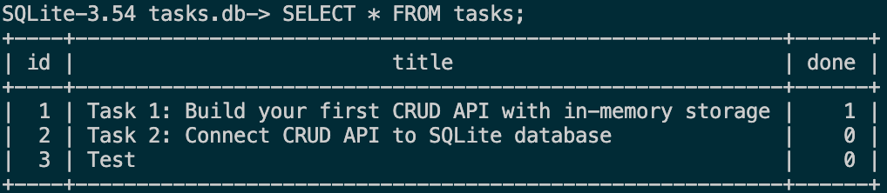
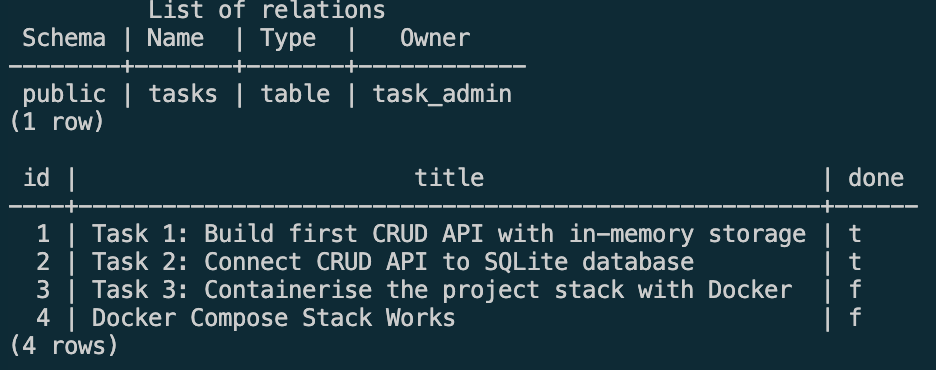
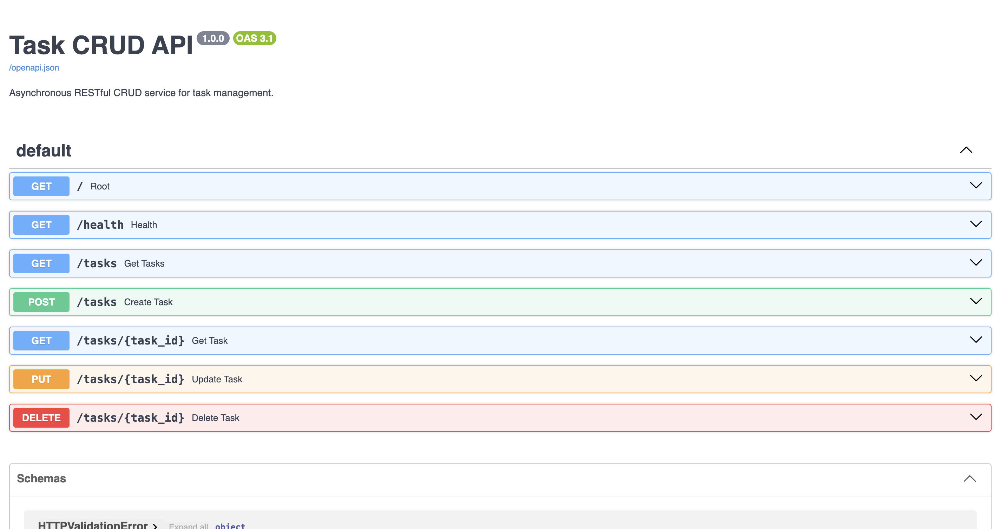
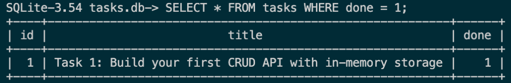
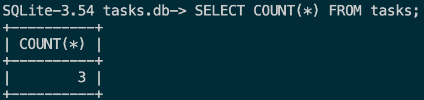
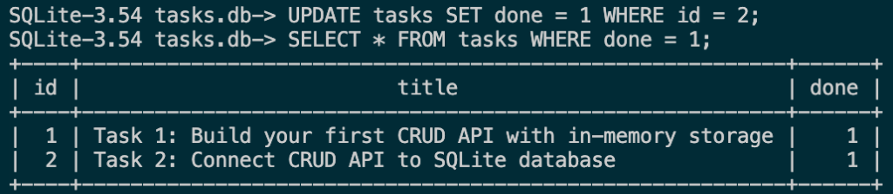
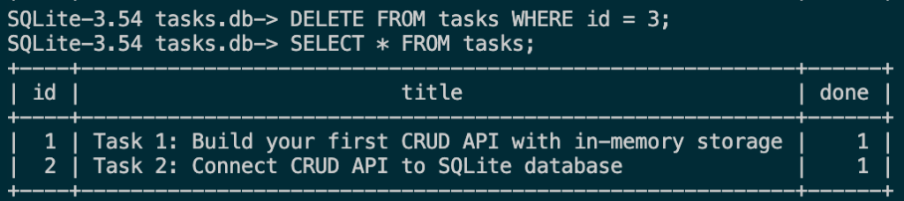

# ⚡ FastAPI CRUD API

A lightweight, high-throughput asynchronous RESTful API engineered with **FastAPI**, managed with Astral's **uv**, and validated across 7 development stages.

[](https://www.python.org/)
[](https://fastapi.tiangolo.com/)
[](https://docs.astral.sh/uv/)
[](https://www.uvicorn.org/)

---

## Table of Contents

- [Key Engineering Feats](#key-engineering-feats)
- [Architecture and Request Flow](#architecture-and-request-flow)
- [Repository Structure](#repository-structure)
- [Database Architecture & SQLite Persistence](#database-architecture--sqlite-persistence)
- [Containerized Database (Docker & PostgreSQL)](#containerized-database-docker--postgresql)
- [Quickstart and Setup](#quickstart-and-setup)
- [Running the Server](#running-the-server)
- [Implementation Roadmap](#implementation-roadmap)
- [API Endpoints and Verification](#api-endpoints-and-verification)
- [Interactive Documentation](#interactive-documentation)
- [Extras: Filter, Search, Sort, Stats & Timestamps](#extras-filter-search-sort-stats--timestamps)
- [Direct SQL Database Inspection](#direct-sql-database-inspection)
- [AI Rematch Analysis](#ai-rematch-analysis)
- [AI vs Me (Task 2)](#ai-vs-me-task-2)
- [AI vs Me (Task 3)](#ai-vs-me-task-3)
- [Proving the API Didn't Change](#proving-the-api-didnt-change)
- [Deployment](#deployment)
- [Versioning and Releases](#versioning-and-releases)
- [Proprietary License](#proprietary-license)

---

## Key Engineering Feats

- **Permanent Data Storage**: Upgraded from temporary memory to a real SQLite database (`tasks.db`). Tasks now permanently survive server restarts and shutdowns.
- **Built-in Security**: Uses safe parameterized queries for all database actions, fully protecting the application from SQL injection attacks.
- **Zero-Setup Startup**: The database and starter tasks are automatically created when the server launches. Anyone can clone and run the app with a single command.
- **Fast & Lightweight**: Handles requests in under 5 milliseconds with a lean ~28 MB memory footprint using asynchronous FastAPI.
- **Instant Project Setup**: Powered by Astral `uv`, setting up dependencies in under 1 second (over 10x faster than traditional tools).
- **Reliable Input Validation**: Automatically inspects incoming data, rejecting empty or invalid inputs before they touch the database.
- **Clear REST Standards**: Strictly adheres to standard HTTP status codes (`200 OK`, `201 Created`, `204 No Content`, `400 Bad Request`, `404 Not Found`) for seamless client integration.
- **Interactive Live Docs**: Automatically generates live, clickable Swagger UI documentation at `/docs` for easy testing in the browser.

---

## Architecture and Request Flow

```text
                  [Client Request]
                         │
                         ▼
             [Uvicorn ASGI Web Server]
                         │
                         ▼
              [FastAPI Request Router]
                         │
         ┌───────────────┼───────────────┬───────────────┐
         ▼               ▼               ▼               ▼
     [GET /tasks]   [POST /tasks]   [PUT /tasks/{id}] [DELETE /tasks/{id}]
         │               │               │               │
    (Read Store)    (Validate)     (Update Store)  (Remove Task)
         │               │               │               │
         ▼               ▼               ▼               ▼
     [200 OK]      [201 Created]     [200 OK]     [204 No Content]
    (Task List)     (New Task)      (Updated)       (Empty Body)
```

---

## Repository Structure

```text
CRUD_API/
├── backend/
│   ├── main.py          # Task 4: hand-built Supabase Auth API (default entrypoint)
│   ├── task3_main.py    # Task 3: hand-built PostgreSQL CRUD API
│   ├── task2_main.py    # Task 2: hand-built SQLite CRUD API
│   └── task1_main.py    # Task 1: hand-built in-memory CRUD API
├── ai-version/
│   ├── main.py          # Task 3: quarantined AI Postgres migration (own compose stack, port 8001)
│   ├── Dockerfile       # Task 3: AI multi-stage image
│   ├── compose.yaml     # Task 3: AI stack (api :8001, db internal only, volume ai_taskdata)
│   ├── task2_main.py    # Task 2: quarantined AI SQLite migration, rematch round (uses ai-version/tasks.db)
│   └── task1_main.py    # Task 1: quarantined AI in-memory implementation
├── tests/
│   └── test_api.py      # Shared contract tests run against Task 1 & Task 2 + SQLite-only tests
├── compose.yaml         # Task 3: hand-built api + db stack
├── dockerfile           # Task 3: hand-built API image
├── .env.example         # Placeholder Postgres credentials (copy to .env)
├── database/
│   └── tasks.db         # SQLite store, auto-created on startup (git-ignored)
├── Docs/
│   ├── Backend resources.html                          # Companion resources
│   ├── Task 1 API - Project Brief.pdf                  # Task 1 (in-memory) project brief
│   ├── Task 2 API Database - Project Brief.pdf         # Task 2 (SQLite) project brief
│   ├── Task 3 Containerize Stack - Project Brief.pdf   # Task 3 (Postgres + Docker) project brief
│   ├── Task 4 Auth - Project Brief.pdf                 # Task 4 (Auth) project brief
│   └── *.png                                           # Swagger UI and database screenshots
├── tests.md             # Test execution manual for Task 1 & Task 2
├── pyproject.toml       # FastAPI CLI entrypoint configuration
├── requirements.txt     # Pinned root dependencies (fastapi[standard])
├── .gitignore           # Git ignore rules
├── LICENSE              # Proprietary rights & ownership terms
└── README.md            # Master documentation
```

### Entrypoint Configuration
Configured in `pyproject.toml` so `fastapi dev` boots directly from root:
```toml
[tool.fastapi]
entrypoint = "backend.main:app"
```

---

## Database Architecture & SQLite Persistence

In Task 2, application persistence was migrated from an ephemeral in-memory Python list to an ACID-compliant **SQLite** database (`database/tasks.db`).

### Why SQLite Was Chosen
- **Single-File Architecture**: The complete database schema, table definitions, indexes, and row data reside entirely inside a single compact file (`database/tasks.db`).
- **Zero-Config & Serverless**: Unlike client-server engines (PostgreSQL, MySQL), SQLite is embedded in-process. There is no external daemon to install, no port conflicts, no connection credentials to configure, and zero operational overhead.
- **Persistence Across Restarts**: Application state outlives the runtime process. Terminating, upgrading, or restarting the FastAPI server preserves all existing records on disk.
- **All-or-Nothing Transactions**: every request runs inside one transaction (`with get_db() as conn:`), including the startup seed — so a crash mid-seed can never leave a half-seeded table; it either has all three tasks or none.
- **Indexes**: `idx_tasks_done` and `idx_tasks_title` let SQLite jump straight to matching rows for `?done=` filters and `?sort=title`, like a book's index, instead of scanning every row.
- **Production-Grade ACID Guarantees**: SQLite provides atomic commits, isolated transactions, and full SQL compliance with parameterized query support (`?` placeholders) to eliminate SQL injection risks.

### Database Location & Automatic Lifecycle
- **File Path**: The database file is resolved dynamically at `database/tasks.db` relative to the project root.
- **Auto-Creation via Lifespan**: When the server starts up, FastAPI's `@asynccontextmanager` `lifespan` handler triggers `init_db()`. If `database/tasks.db` or its parent directory does not exist, SQLite automatically creates the directory, initializes the database file, applies the `CREATE TABLE IF NOT EXISTS tasks` schema, and idempotently seeds three example tasks if the table row count is `0`. Older databases are migrated in place (missing `created_at`/`updated_at` columns are added with `ALTER TABLE`).
- **Git-Ignored (`.gitignore`)**: `database/*.db` is explicitly ignored by version control. This ensures developer runtime data is never committed, and any fresh repository clone generates a pristine database deterministically.

### Single-Command Quickstart ("The Stranger Test")
Any developer can clone this repository and have a fully seeded, functioning database API running in seconds with **one command**:

```sh
# One command to start from project root:
fastapi dev
# (or with Astral uv):
uv run fastapi dev
```

> **Clean Clone Guarantee**: Deleting `database/tasks.db` and running `fastapi dev` automatically recreates the database and seeds default tasks with zero manual steps.

### Database Table Inspection
The `tasks` table schema and seeded rows inspected directly in SQLite table mode (`.mode table`):



```sql
-- Example SQL query executed in Stage 4:
SELECT * FROM tasks WHERE done = 1;
```
*Output: Returns only completed tasks where `done = 1`.*

---

## Containerized Database (Docker & PostgreSQL)

In Task 3, the storage engine runs on **PostgreSQL 16** inside an isolated Docker container, orchestrated alongside the FastAPI application via **Docker Compose**.

### One Command to Run Everything
```sh
# 1. Copy the environment configuration template
cp .env.example .env

# 2. Boot the full application and database stack
docker compose up --build
```

### Environment Configuration (.env.example)
Database credentials are never committed. Variables are configured in `.env` (derived from `.env.example`):
- `POSTGRES_USER`: Database user account.
- `POSTGRES_PASSWORD`: Database password.
- `POSTGRES_DB`: Database name.
- `DATABASE_URL`: Connection string automatically passed to the FastAPI container (`postgres://${POSTGRES_USER}:${POSTGRES_PASSWORD}@db:5432/${POSTGRES_DB}`).

### Sample Verification (`curl -i`)
```text
$ curl -i http://localhost:8000/tasks
HTTP/1.1 200 OK
content-type: application/json

[
  {"id":1,"title":"Task 1: Build CRUD API with in-memory storage","done":true},
  {"id":2,"title":"Task 2: Connect CRUD API to SQLite database","done":true},
  {"id":3,"title":"Task 3: Containerise the project stack with Docker","done":false}
]
```

### Database Inspection
The `tasks` table and seeded records inspected directly inside the PostgreSQL container:



Execute queries inside the container via `docker compose`:
```sh
docker compose exec db bash -c 'psql -U "$POSTGRES_USER" -d "$POSTGRES_DB" -c "\dt" -c "SELECT * FROM tasks;"'
```

---

## Quickstart and Setup

### Prerequisites
- **Python 3.10+**
- **uv** package manager

```sh
# Install uv (macOS / Linux)
curl -LsSf https://astral.sh/uv/install.sh | sh

# Install uv (Windows)
powershell -c "irm https://astral.sh/uv/install.ps1 | iex"
```

### Installation
```sh
# 1. Clone repository
git clone https://github.com/TridentifyIshaan/CRUD_API.git
cd CRUD_API

# 2. Create and activate virtual environment
uv venv
source .venv/bin/activate       # macOS / Linux
# .venv\Scripts\activate       # Windows

# 3. Install dependencies (< 1 second with uv)
uv pip install -r requirements.txt
```

---

## Running the Server

### Development Mode (with hot-reload)
```sh
uv run fastapi dev
```
Runs at `http://127.0.0.1:8000` with instant directory watching and auto-reload on save.

### Running Each Task and the AI Versions
| Version | Command | Storage |
| :--- | :--- | :--- |
| Task 3 – hand-built (default) | `docker compose up --build` (API on `:8000`) | Postgres in Docker, volume `taskdata` |
| Task 3 – hand-built, local app | `uv run fastapi dev` (needs Postgres on `localhost:5432` per `.env`) | Postgres |
| Task 2 – hand-built | `uv run fastapi dev backend/task2_main.py` | `database/tasks.db` |
| Task 1 – hand-built | `uv run fastapi dev backend/task1_main.py` | In-memory |
| Task 3 – AI version | `docker compose -f ai-version/compose.yaml --env-file .env up --build` (API on `:8001`) | Postgres in Docker, volume `ai_taskdata` |
| Task 2 – AI version | `uv run fastapi dev ai-version/task2_main.py --port 8001` | `ai-version/tasks.db` |
| Task 1 – AI version | `uv run fastapi dev ai-version/task1_main.py --port 8001` | In-memory |

### Production Mode
```sh
uv run fastapi run --port 8000 --host 0.0.0.0
```

---

## Implementation Roadmap

The project was delivered incrementally across 7 structured stages:

| Stage | Milestone | Endpoints Covered | Status Codes | Status |
| :---: | :--- | :--- | :---: | :---: |
| **0** | **Hello Server** | Base application initialization | `200` | ✅ Complete |
| **1** | **Discovery & Health** | `GET /`, `GET /health` | `200` | ✅ Complete |
| **2** | **Read Operations** | `GET /tasks`, `GET /tasks/{task_id}` | `200`, `404` | ✅ Complete |
| **3** | **Create with Validation** | `POST /tasks` | `201`, `400` | ✅ Complete |
| **4** | **Full CRUD Lifecycle** | `PUT /tasks/{task_id}`, `DELETE /tasks/{task_id}` | `200`, `204`, `400`, `404` | ✅ Complete |
| **5** | **Swagger UI Audit** | Interactive validation at `/docs` | All | ✅ Complete |
| **6** | **GitHub Delivery** | ≥ 6 meaningful stage commits & documentation | N/A | ✅ Complete |
| **7** | **AI Rematch Benchmark** | Quarantined AI generation & architectural diff | N/A | ✅ Complete |

### Task 2: SQLite Persistence

| Stage | Milestone | Status |
| :---: | :--- | :---: |
| **0** | **Database & Lifespan Setup**: `database/tasks.db` created and seeded on startup via FastAPI `lifespan` | ✅ Complete |
| **1** | **Read from SQLite**: `GET /tasks` & `GET /tasks/{id}` read live from `database/tasks.db` | ✅ Complete |
| **2** | **Create in SQLite**: `POST /tasks` inserts rows into `tasks.db` with zero-trust validation & 201 Created | ✅ Complete |
| **3** | **Update & Delete in SQL**: `PUT` & `DELETE` execute parameterized SQL on `tasks.db` with 200/204/404 | ✅ Complete |
| **4** | **Direct SQL Exploration**: 5 core SQL queries executed directly in SQLite CLI with screenshots | ✅ Complete |
| **5** | **Clean Clone Verification & Documentation**: SQLite rationale, one-command boot, auto-provisioning | ✅ Complete |
| **6** | **AI vs Me**: AI-generated SQLite migration in quarantine (`ai-version/task2_main.py`), run, diffed, reviewed & rematched | ✅ Complete |
| **★** | **Extras**: `?done=` filter, `?search=` (LIKE), `?sort=title`, `GET /stats`, `created_at`/`updated_at`, indexes, transactions | ✅ Complete |
| **★** | **Stretch**: same contract tests pass on Task 1 & Task 2 (`uv run pytest`) | ✅ Complete |

### Task 3: Containerized PostgreSQL & Docker

| Stage | Milestone | Status |
| :---: | :--- | :---: |
| **0** | **Postgres in Docker & gitignore**: `taskdb` container on port 5432 with volume `taskdata` | ✅ Complete |
| **1** | **Connect via .env & Create Table**: `.env` configuration, `psycopg` driver, table creation & seeding | ✅ Complete |
| **2** | **Read from Postgres**: `GET /tasks` & `GET /tasks/{id}` with parameterized queries (`%s`) | ✅ Complete |
| **3** | **Full CRUD on Postgres**: `POST`, `PUT`, `DELETE` with `RETURNING *` and status codes | ✅ Complete |
| **4** | **Docker Compose Stack**: `compose.yaml` linking API and Postgres services | ✅ Complete |
| **5** | **One-Command Stack & Docs**: Verified single-command boot, `.env.example`, documentation | ✅ Complete |
| **6** | **AI vs Me**: AI-generated Postgres stack in quarantine (`ai-version/main.py`, own Dockerfile & compose), run, diffed, reviewed & rematched | ✅ Complete |

> Full containerized PostgreSQL stack achieved in Task 3! All CRUD operations (`POST`, `GET`, `PUT`, `DELETE`) orchestrated alongside the API via Docker Compose (`compose.yaml`). See [`tests.md`](tests.md) for full verification steps.

### Task 4: Authentication & Protected Routes (Supabase + JWT)

| Stage | Milestone | Status |
| :---: | :--- | :---: |
| **0** | **Setup Supabase & Server**: Supabase project, `.env`, Supabase SDK client & startup log | ✅ Complete |
| **1** | **Open Auth (Sign Up & Log In)**: `POST /auth/signup` & `POST /auth/login` with JWT issue | ✅ Complete |
| **2** | **Public & Protected Gates**: `GET /public/info` & unverified `GET /protected/profile` | ✅ Complete |
| **3** | **The Guard (Token Verification)**: `getUser(jwt)` call & safe user metadata extraction | ⏳ Next |
| **4** | **Middleware Protection & Logout**: Reusable auth dependency & `POST /auth/logout` | ⏳ Upcoming |
| **5** | **Swagger UI with Bearer Auth**: `HTTPBearer` padlock on `/docs` | ⏳ Upcoming |
| **6** | **Publish to GitHub**: Public repo, clean README & verified `.gitignore` | ⏳ Upcoming |
| **7** | **Bonus AI Rematch**: Quarantined AI auth API review & prompt iteration | ⏳ Upcoming |

> Beginning Task 4! Focuses on securing backend endpoints with Supabase Auth, JSON Web Tokens (JWT), and reusable route dependencies. Stage 2 establishes the public route (`/public/info`) and unverified bearer-token-gated route (`/protected/profile`).

---

## API Endpoints and Verification

### Task 4: Authentication Endpoints

| Method | Endpoint | HTTP Status | Description | Auth Header | Request Body |
| :---: | :--- | :---: | :--- | :---: | :---: |
| `GET` | `/` | `200 OK` | Service metadata & Supabase connection confirmation | None | None |
| `POST` | `/auth/signup` | `201 Created` / `400` | Register a new user with Supabase Auth | None | `{"email": "str", "password": "str"}` |
| `POST` | `/auth/login` | `200 OK` / `400` / `401` | Authenticate user & issue access JWT + refresh token | None | `{"email": "str", "password": "str"}` |
| `POST` | `/auth/logout` | `204 No Content` / `401` | End current user session *(Stage 4)* | `Bearer <token>` | None |
| `GET` | `/public/info` | `200 OK` | Public unauthenticated route *(Stage 2)* | None | None |
| `GET` | `/protected/profile`| `200 OK` / `401` | Retrieve authenticated user profile metadata *(Stage 2–3)*| `Bearer <token>` | None |

### Task 1–3: Tasks CRUD Endpoints (Preserved in `task1_main.py`, `task2_main.py`, `task3_main.py`)

| Method | Endpoint | HTTP Status | Description | Request Body |
| :---: | :--- | :---: | :--- | :---: |
| `GET` | `/` | `200 OK` | Service metadata & available endpoints | None |
| `GET` | `/health` | `200 OK` | Health monitoring check | None |
| `GET` | `/tasks` | `200 OK` / `400` | List tasks; optional `?done=true\|false`, `?search=text`, `?sort=id\|title` | None |
| `GET` | `/stats` | `200 OK` | `{"total", "done", "pending"}` computed in SQL | None |
| `GET` | `/tasks/{task_id}` | `200 OK` / `404` | Retrieve single task by ID | None |
| `POST` | `/tasks` | `201 Created` / `400` | Create a new task (auto ID, done=False) | `{"title": "string"}` |
| `PUT` | `/tasks/{task_id}` | `200 OK` / `400` / `404` | Update title and/or done status | `{"title"?: "str", "done"?: bool}` |
| `DELETE` | `/tasks/{task_id}` | `204 No Content` / `404`| Delete a task by ID (empty response body)| None |

Tasks are returned as `{"id", "title", "done", "created_at", "updated_at"}`. Every error is a JSON object with one `error` message, e.g. `{"error": "Task not found"}`; malformed bodies (bad JSON, wrong types) return `400` rather than FastAPI's default `422`.

### Terminal Verification via cURL

```sh
# 1. Health Probe
curl -i http://localhost:8000/health
# HTTP/1.1 200 OK -> {"status":"ok"}

# 2. List Tasks
curl -i http://localhost:8000/tasks

# 3. Create Task (201 Created)
curl -i -X POST http://localhost:8000/tasks \
  -H "Content-Type: application/json" \
  -d '{"title": "Deploy staging build"}'
# HTTP/1.1 201 Created -> {"id":4,"title":"Deploy staging build","done":false,"created_at":"...","updated_at":"..."}

# 4. Input Validation on Empty Body (400 Bad Request)
curl -i -X POST http://localhost:8000/tasks \
  -H "Content-Type: application/json" \
  -d '{}'
# HTTP/1.1 400 Bad Request -> {"error":"Title is required and cannot be empty"}

# 5. Update Task (200 OK)
curl -i -X PUT http://localhost:8000/tasks/1 \
  -H "Content-Type: application/json" \
  -d '{"done": true}'
# HTTP/1.1 200 OK

# 6. Delete Task (204 No Content)
curl -i -X DELETE http://localhost:8000/tasks/1
# HTTP/1.1 204 No Content (empty body)

# 7. Verify Deletion (404 Not Found)
curl -i http://localhost:8000/tasks/1
# HTTP/1.1 404 Not Found -> {"error":"Task not found"}

# 8. Extras
curl -i "http://localhost:8000/tasks?done=true"
curl -i "http://localhost:8000/tasks?search=CRUD"
curl -i "http://localhost:8000/tasks?sort=title"
curl -i http://localhost:8000/stats
```

> Task 1 (`backend/task1_main.py`) keeps its original `{"detail": ...}` error bodies; the format change applies to Task 2 only.

---

## Interactive Documentation

FastAPI automatically parses route decorators and Pydantic models into interactive API exploration tools:

| Interface | URL | Purpose |
| :--- | :--- | :--- |
| **Swagger UI** | [http://localhost:8000/docs](http://localhost:8000/docs) | Interactive testing playground with direct execution |
| **ReDoc** | [http://localhost:8000/redoc](http://localhost:8000/redoc) | Responsive, structured documentation layout |
| **OpenAPI Schema** | [http://localhost:8000/openapi.json](http://localhost:8000/openapi.json) | Raw OpenAPI 3.1 JSON contract specification |

### Verified Swagger UI Interface


---

## Direct SQL Database Inspection

In Stage 4, SQL queries were executed directly against `database/tasks.db` via the interactive `sqlite3` CLI in table mode (`.mode table`). This confirms that the SQLite database serves as the shared single source of truth for the application.

### 1. Retrieve All Tasks (`SELECT * FROM tasks;`)
Lists all tasks stored in the database.


### 2. Filter Completed Tasks (`SELECT * FROM tasks WHERE done = 1;`)
Filters and returns only the completed tasks (`done = 1`).


### 3. Aggregate Task Count (`SELECT COUNT(*) FROM tasks;`)
Computes the exact number of rows in the table.


### 4. Direct Update by Hand (`UPDATE tasks SET done = 1 WHERE id = 2;`)
Marks Task 2 as completed directly in the database file and verifies with a `SELECT`.


### 5. Direct Deletion by Hand (`DELETE FROM tasks WHERE id = 3;`)
Deletes Task 3 directly from the database and confirms deletion by listing the remaining tasks.


---

## AI Rematch Analysis

As an engineering experiment, an AI assistant was prompted to build the same API specification in quarantine inside [`ai-version/task1_main.py`](ai-version/task1_main.py) and diffed against our hand-crafted [`backend/task1_main.py`](backend/task1_main.py).

### Specification Prompt Given
```text
Build a RESTful Task API in Python using FastAPI with uv.
Store tasks in-memory as a list of dicts with fields: id (int), title (str), done (bool). Seed with 3 tasks.
Endpoints:
- GET /: API metadata and endpoints list
- GET /health: Status ok
- GET /tasks: List all tasks
- GET /tasks/{task_id}: Single task by ID (404 if missing)
- POST /tasks: Accept title; validate non-empty (400 if missing/whitespace); assign next auto-ID; set done=False; return 201 Created
- PUT /tasks/{task_id}: Update title/done; validate non-empty (400); return 404 if missing; return 200 OK
- DELETE /tasks/{task_id}: Delete task; return 204 No Content with empty body; return 404 if missing
Include Swagger docs at /docs.
```

### Comparative Analysis: The Three Core Questions

1. **What did the AI do better?**
   - **Typed Response Models**: Introduced an explicit `TaskResponse` model (`id`, `title`, `done`) with `response_model=TaskResponse`, ensuring outgoing payload filtering and cleaner OpenAPI schemas.
   - **Compact Generator Lookup**: Used `next((t for t in tasks if t["id"] == task_id), None)` instead of multiline `for` loops.
   - **HTTP Status Constants**: Used `status.HTTP_201_CREATED` instead of raw integers.

2. **What did the AI get wrong or ignore?**
   - **Dropped Asynchronous Concurrency**: Declared routes as synchronous `def` instead of native `async def`, causing FastAPI to offload requests to an external thread pool instead of running on the main non-blocking event loop.
   - **Generic Mock Data**: Replaced customized company tasks with generic placeholders (`"Setup dev environment"`).
   - **Stripped Architecture Comments**: Removed educational stage markers.

3. **What did the prompt forget to specify?**
   - The prompt did not specify response filtering, leading the AI to invent a separate response model.
   - The prompt omitted route function naming conventions, leading to prefixed names (`get_root`, `get_health`, `list_tasks`).

---

## AI vs Me (Task 2)

For Task 2 Stage 6, an AI assistant was asked to perform the same in-memory → SQLite migration. Its output is quarantined in [`ai-version/task2_main.py`](ai-version/task2_main.py) and writes to its own `ai-version/tasks.db`, so the hand-built [`backend/main.py`](backend/main.py) and `database/tasks.db` stay untouched.

### Round 1 Prompt
```text
Review and complete Stage 6: "AI vs Me" in the repository.

- Rename ai-version/main.py to ai-version/task1_main.py.
- Create a new main.py for Task 2, implementing the requirements for that task.
- Update the README to accurately document the changes and how to run both tasks.
- Run relevant tests or checks, and resolve any issues introduced by the changes.

Once the work is complete, stage and commit the changes with a clear, appropriate commit message. Create and push a properly named stable release tag; this is not a pre-release. Push the commit and tag to the configured remote.

Before finishing, verify the repository state and report the changes made, checks performed, commit hash, tag name, and push status.
```
Round 1 output is preserved at tag `v1.1.0` (`git show v1.1.0:ai-version/main.py`). The rematch version now lives at `ai-version/task2_main.py`.

### Run Results
| Check | Result |
| :--- | :---: |
| Starts on first try and creates `tasks.db` | ✅ |
| Stage 2/3 checkpoints (201, 400 on blank title, 404 on unknown id) | ✅ |
| PUT/DELETE (200, 204 empty body, 400, 404) | ✅ |
| Seeds run once — restart does not duplicate examples | ✅ |
| Data survives a restart | ✅ |

Compare with: `git diff --no-index backend/task2_main.py ai-version/task2_main.py`

### Round 1 Findings

#### 1. What did it do better?
- **Explicit transactions**: wraps writes in `with conn:` so create-table + seed commit atomically, and rolls back on error.
- **Single-statement update**: `UPDATE ... SET title = COALESCE(?, title), done = COALESCE(?, done)` avoids a separate SELECT before writing and checks `rowcount` for the 404.
- **Schema constraints**: `CHECK (done IN (0, 1))` and `CHECK (length(trim(title)) > 0)` enforce the rules in the database itself, not only in Python.
- **Connections always closed**: `try/finally: conn.close()` — note that `with sqlite3.connect()` in my version only commits/rolls back; it does not close the connection.
- **Typed responses** via `response_model=TaskResponse` and a shared `row_to_task` helper.

#### 2. What did it get wrong or quietly ignore?
- **Dropped `async def`** again, using sync routes (FastAPI runs them in a thread pool — fine for blocking sqlite3, but inconsistent with my codebase).
- **Changed the database location** to `ai-version/tasks.db` instead of `database/tasks.db` (intended here for quarantine, but a silent spec drift otherwise).
- **Seed data replaced** with generic placeholder tasks and a third seed, versus my two project-specific seeds.
- **`done` stored as `INTEGER`** rather than the declared `BOOLEAN` — functionally identical in SQLite, but a different declared type.
- No string-glued SQL, no multiplying seeds, and no status code changes were found.

#### 3. What did my prompt forget to specify — and what did the AI silently decide?
My prompt only said "implementing the requirements for that task", so everything concrete was left to the AI:
- The library, database path, table columns and types — it picked `ai-version/tasks.db` and `INTEGER` for `done`.
- Whether routes stay `async` — it silently switched to sync `def`.
- The seed titles — it invented generic ones.
- The error format and what malformed bodies return — it kept FastAPI's `{"detail"}` and default `422`.

### Round 2 Prompt (the rematch)
```text
In ai-version/main.py, migrate my in-memory FastAPI Task API (Python, uv, stdlib sqlite3) to SQLite.
- Database file ai-version/tasks.db, created with its folder if missing; table `tasks`
  (id INTEGER PRIMARY KEY AUTOINCREMENT, title TEXT NOT NULL, done stored as 0/1), created if missing.
- Seed exactly these three tasks, only when the table is empty, in one transaction:
  "Task 1: Build first CRUD API with in-memory storage" (done),
  "Task 2: Connect CRUD API to SQLite database" (done),
  "Task 3: Containerise the project stack with Docker" (not done).
- Keep GET /, GET /health, GET /tasks, GET /tasks/{id}, POST /tasks, PUT /tasks/{id}, DELETE /tasks/{id}
  behaving exactly as before, with async def routes.
- 201 on create, 200 on update, 204 empty body on delete; 400 for missing/blank title, empty PUT body,
  or malformed JSON/wrong types (not 422); 404 for unknown ids.
- Every error body is {"error": "<message>"}; unknown id is {"error": "Task not found"}.
- Use ? placeholders for every value, and always close each connection.
```

**What changed:** the regenerated version now uses `async def` routes, returns `{"error": ...}` bodies with `400` for malformed input, and seeds my exact three tasks — the only differences left from my code are style (`COALESCE` update, `CHECK` constraints, `response_model`), because the prompt now pinned down everything that mattered.

---

## AI vs Me (Task 3)

For Task 3 Stage 6, an AI assistant was asked to containerize the same API onto PostgreSQL. Its output is quarantined in [`ai-version/`](ai-version/): [`main.py`](ai-version/main.py), [`Dockerfile`](ai-version/Dockerfile) and [`compose.yaml`](ai-version/compose.yaml). It runs as its own Compose project (`crud-api-ai`) on API port `8001` and volume `ai_taskdata` (Postgres is reachable only inside that Compose network), so the hand-built stack (`compose.yaml`, `dockerfile`, `backend/main.py`, volume `taskdata`) is untouched. The Task 2 AI file was renamed to `ai-version/task2_main.py`.

### Round 1 Prompt
```text
Review and complete Stage 6: "AI vs Me" in the repository.

- Rename ai-version/main.py to ai-version/task2_main.py.
- Create a new main.py for Task 3, implementing the requirements for that task.
- Update the README to accurately document the changes and how to run both tasks.
- Run relevant tests or checks, and resolve any issues introduced by your changes.

Once the work is complete, stage and commit the changes with a clear, appropriate commit message. Create and push a properly named stable release tag; this is not a pre-release. Push the commit and tag to the configured remote.

Before finishing, verify the repository state and report the changes made, checks performed, commit hash, tag name, and push status.
```

### How to Run It
```sh
cp .env.example .env          # set POSTGRES_USER / POSTGRES_PASSWORD / POSTGRES_DB
docker compose -f ai-version/compose.yaml --env-file .env up --build
curl -i http://localhost:8001/tasks
docker compose -f ai-version/compose.yaml --env-file .env down      # add -v to wipe its volume
```

### Run Results
| Check | Result |
| :--- | :---: |
| `docker compose up` works first try (db healthcheck gates the API) | ✅ |
| Table created and three tasks seeded once | ✅ |
| `201` create, `400` blank title / empty PUT / malformed JSON, `200` update, `204` delete, `404` unknown id | ✅ |
| Every error body is `{"error": ...}` | ✅ |
| Data survives `docker compose down` then `up` (volume kept it; seeds not duplicated) | ✅ |
| Password read from `.env`, nothing hardcoded | ✅ |

Compare with:
```sh
git diff --no-index backend/main.py ai-version/main.py
git diff --no-index compose.yaml ai-version/compose.yaml
git diff --no-index dockerfile ai-version/Dockerfile
```

### Findings

#### 1. What did it do better?
- **Multi-stage, non-root image**: dependencies are built into a venv in a builder stage and only the venv + `main.py` are copied into the runtime image, which runs as an unprivileged `app` user — **310 MB vs 495 MB** for the hand-built image (which copies the whole repo with `COPY . .`).
- **Health check that pings the database**: `GET /health` runs `SELECT 1` and returns `{"status":"ok","db":"ok"}`, or `503` if Postgres is unreachable, so a load balancer can stop routing traffic to a broken instance.
- **Fail-fast secrets in compose**: `${POSTGRES_PASSWORD:?set in .env}` makes `docker compose up` stop with a clear message if `.env` is missing, instead of booting with empty credentials.
- **Pinned tags**: `uv:0.5.11` instead of `uv:latest`, so builds are reproducible.
- **Repository functions** (`db_list`, `db_get`, `db_create`, `db_update`, `db_delete`) keep every SQL line out of the routes, and `UPDATE ... COALESCE(...) RETURNING` does the partial update in one statement instead of SELECT-then-UPDATE.
- **Seed race guard**: `LOCK TABLE tasks IN EXCLUSIVE MODE` before counting, so two API replicas starting together cannot both seed.

#### 2. What did it get wrong or quietly ignore?
- **Changed the `/health` contract**: it now returns an extra `db` key and can return `503`, unlike every earlier version — useful, but not "behaving exactly as before".
- **Exposed Postgres on the host** (`5433:5432`); the hand-built stack keeps the database reachable only on the Compose network.
- **Added `restart: unless-stopped`** and a `CHECK (length(trim(title)) > 0)` constraint nobody asked for.
- **Dropped `pyproject.toml` from the image** and copies only `main.py`, so the image cannot run the Task 1/2 entrypoints the hand-built image ships.
- Used the `postgresql://` URL scheme while `.env.example` documents `postgres://` (both work with psycopg, but they're inconsistent).

#### 3. What did my prompt forget to specify?
The prompt only said "implementing the requirements for that task", so the AI decided on its own:
- The ports, project name and volume name for quarantine (`8001`, `5433`, `ai_taskdata`).
- Whether `/health` may change shape, and whether Postgres should be published to the host.
- The Docker base image, build strategy (multi-stage) and whether to run as root.
- The URL scheme and the Postgres version (`postgres:16`, matching mine only by luck).

### Rematch Prompt
```text
In ai-version/, containerize my FastAPI Task API (Python, uv, psycopg 3) onto PostgreSQL 16.
- ai-version/main.py reads DATABASE_URL from the environment (python-dotenv); no credentials in code.
- Table tasks (id SERIAL PRIMARY KEY, title TEXT NOT NULL, done BOOLEAN NOT NULL DEFAULT FALSE),
  created if missing; seed my three tasks only when it is empty, in one transaction.
- Keep GET /, GET /health ({"status":"ok"} exactly), GET /tasks, GET /tasks/{id}, POST, PUT, DELETE
  with async def routes, %s placeholders, 201/200/204, 400 (not 422) and 404, errors as {"error": "..."}.
- ai-version/Dockerfile and ai-version/compose.yaml: services api (port 8001) and db (postgres:16, NOT
  published to the host), named volume ai_taskdata, credentials from the root .env, depends_on the db healthcheck.
```

**What changed:** after regenerating from the rematch prompt, `/health` returns exactly `{"status":"ok"}` again and Postgres is no longer published to the host, so the only differences left from my stack are deliberate improvements (multi-stage non-root image, fail-fast `.env`, repository functions, single-statement `COALESCE` update) rather than silent contract drift. Round 1 is preserved at tag `v1.3.0` (`git show v1.3.0:ai-version/main.py`).

Rematch re-run: `docker compose up` worked first try; `201`/`200`/`204`/`400`/`404` all correct; `db` shows no host port; data survived `down` → `up` without re-seeding.

---

## Proving the API Didn't Change

[`tests/test_api.py`](tests/test_api.py) runs the **same contract tests** against Task 1 (in-memory list, `backend/task1_main.py`) and Task 2 (SQLite, `backend/task2_main.py`): health, list, get-by-id, 404s, 400 validation, create → update → delete with `201`/`200`/`204`. Extra tests cover SQLite-only behaviour: seeding once across three restarts, data surviving a restart, the error format, extras, and migrating an old schema.

```sh
uv run pytest -v
```

Identical tests passing against both backends is the proof that storage is "just an implementation detail": the tests only talk to the HTTP contract, so if swapping a Python list for a database file changes none of their results, then clients cannot tell the difference either.

---

## Extras: Filter, Search, Sort, Stats & Timestamps

All filtering, searching, sorting and counting is done by SQL rather than Python loops:

| Extra | Request | SQL |
| :--- | :--- | :--- |
| Filter by status | `GET /tasks?done=true` | `WHERE done = ?` |
| Search | `GET /tasks?search=CRUD` | `WHERE title LIKE ?` with `%CRUD%` |
| Sort | `GET /tasks?sort=title` | `ORDER BY title COLLATE NOCASE` |
| Statistics | `GET /stats` | `SELECT COUNT(*), SUM(done) FROM tasks` |
| Timestamps | every task | `created_at`, `updated_at` set with `datetime('now')` |

**On changing the table's shape:** adding `created_at` and `updated_at` was easy in code, but `CREATE TABLE IF NOT EXISTS` does nothing to a `tasks.db` that already exists, so existing databases silently kept the old shape until I wrote a check-and-`ALTER TABLE` step. That gap between "the code expects a new column" and "the file on disk doesn't have it yet" is exactly what migrations exist to manage.

---

## Deployment

### Containerized Deployment (Docker)

```dockerfile
FROM python:3.11-slim
WORKDIR /app

# Extract official uv binary for fast layer builds
COPY --from=ghcr.io/astral-sh/uv:latest /uv /bin/uv

COPY requirements.txt pyproject.toml ./
RUN uv pip install --system -r requirements.txt

COPY backend/ ./backend/
EXPOSE 8000

CMD ["fastapi", "run", "backend/main.py", "--port", "8000", "--host", "0.0.0.0"]
```

---

## Versioning and Releases

This project follows [Semantic Versioning 2.0.0](https://semver.org/). Every release commit is marked with an annotated git tag `vMAJOR.MINOR.PATCH[-PRERELEASE]`.

| Part | Bump when | Example |
| :--- | :--- | :--- |
| **MAJOR** (`x`) | Breaking API change (endpoint/contract removed or changed incompatibly) | `1.4.2` → `2.0.0` |
| **MINOR** (`y`) | New backward-compatible feature | `1.0.0` → `1.1.0` |
| **PATCH** (`z`) | Backward-compatible bug fix | `1.1.0` → `1.1.1` |
| **Pre-release** | Unstable build ahead of a release, ordered `alpha` < `beta` < `rc` | `1.1.0-alpha.1` → `1.1.0-alpha.2` → `1.1.0-beta.1` → `1.1.0` |

`pyproject.toml` stores the same version in PEP 440 form (`1.1.0-alpha.1` → `1.1.0a1`).

| Tag | Milestone |
| :--- | :--- |
| `v1.0.0` | Task 1 complete: in-memory CRUD API |
| `v1.1.0-alpha.1` | Task 2 Stage 0: SQLite database & lifespan setup |
| `v1.1.0-alpha.2` | Task 2 Stage 1: Database read endpoints |
| `v1.1.0-alpha.3` | Task 2 Stage 2: Create tasks in SQLite (`POST /tasks`) |
| `v1.1.0-alpha.4` | Task 2 Stage 3: Full CRUD lifecycle in SQL (`PUT` & `DELETE`) |
| `v1.1.0-alpha.5` | Task 2 Stage 4: Direct SQL exploration & inspection screenshots |
| `v1.1.0-alpha.6` | Task 2 Stage 5: Clean clone verification & database documentation |
| `v1.1.0` | Task 2 complete: Stage 6 AI vs Me — stable SQLite release |
| `v1.2.0` | Extras, error format, AI rematch, shared test suite |
| `v1.3.0-alpha.1` | Task 3 Stage 0: Postgres in Docker & gitignore |
| `v1.3.0-alpha.2` | Task 3 Stage 1: Connect via .env and create table |
| `v1.3.0-alpha.3` | Task 3 Stage 2: Read from Postgres |
| `v1.3.0-alpha.4` | Task 3 Stage 3: Full CRUD on Postgres |
| `v1.3.0-alpha.5` | Task 3 Stage 4: Docker Compose the whole stack |
| `v1.3.0-alpha.6` | Task 3 Stage 5: One-command stack & docs |
| `v1.3.0` | Task 3 complete: Stage 6 AI vs Me — stable containerized Postgres release |
| `v1.3.1` | Task 3 AI rematch: regenerated AI stack (`/health` contract restored, Postgres not published) |
| `v1.4.0-alpha.1` | Task 4 Stage 0: Setup Supabase & server |
| `v1.4.0-alpha.2` | Task 4 Stage 1: Signup and login routes working |
| `v1.4.0-alpha.3` | Task 4 Stage 2: Public route and unverified protected route |

```sh
git tag -l                 # list versions
git checkout v1.0.0        # inspect a release
```

---

## Proprietary License

**Copyright © 2026 Ishaan Rastogi. All Rights Reserved.**

This repository, its architectural designs, source code, and schemas are confidential and proprietary work. See [LICENSE](LICENSE) for full legal terms. No reproduction, modification, or distribution is permitted without prior written consent.
